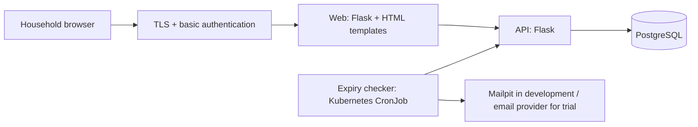

# FreshTrack

A household food expiry tracker designed to help people remember what they have, use food earlier, and reduce avoidable waste.

FreshTrack is Samson's DevOps, Cloud, and SRE portfolio project, with his own household as the first intended user. It connects a practical food-storage problem with hands-on work in testing, container security, continuous integration, Kubernetes, and operations.

**Current stage:** API skeleton with container CI that publishes the image to Docker Hub. The household application is still being built; grocery tracking and email reminders are planned.

## Contents

- [Project status](#project-status)
- [Version 1 plan](#version-1-plan)
- [Architecture](#architecture)
- [Run locally](#run-locally)
- [Configuration and endpoints](#configuration-and-endpoints)
- [Run checks](#run-checks)
- [CI pipeline](#ci-pipeline)
- [Security and current limits](#security-and-current-limits)
- [Roadmap](#roadmap)
- [Repository layout](#repository-layout)
- [Project documentation](#project-documentation)

## Project status

| Area | Current state |
|---|---|
| API skeleton | Flask app with `/health` and database-aware `/ready` endpoints |
| Tests | Four pytest tests covering health and readiness responses; successful database access is mocked |
| Container | Gunicorn server, digest-pinned Python base image, hash-locked dependencies, non-root UID `10001` |
| CI | Ruff, pytest, Bandit, Trivy source scan, image build, startup smoke test, and image scans |
| Registry publishing | [`samayohub/freshtrack-api`](https://hub.docker.com/r/samayohub/freshtrack-api) on Docker Hub, tagged with the commit SHA, pushed only from `main` |
| Household features | Planned: grocery storage, active list, item status updates, and reminders |
| Deployment | Planned: Minikube first, then a short k3s trial on AWS |

The implemented API endpoints are a foundation for the application. There are currently no grocery routes, database schema, web pages, or reminder worker. See the [architecture status rules](docs/architecture.md) for what qualifies as Built.

## Version 1 plan

The first release serves one household:

- Add food with a name, quantity, storage location (`fridge`, `freezer`, or `cupboard`), label date, and date type (`best_before` or `expiration`).
- Show active items with the closest label dates first.
- Mark items as used or discarded, retaining their records for the household trial.
- Send one morning email in `America/Toronto`, listing active items within three days of their label date or already past it.
- Use distinct wording for best-before and expiration dates.

FreshTrack organises reminders; it never determines whether food is safe to eat.

Account registration, multiple households, native mobile apps, barcode or receipt scanning, recipes, and automatic grocery ordering are outside version 1.

## Architecture

The following is the **planned application architecture**. Only the API skeleton exists today.



Only the API will access PostgreSQL. The web app and expiry checker will call the API so validation and reminder rules stay in one place. Mailpit will capture development email without sending it to real recipients.

The deployment plan uses Minikube as the main lab, Helm for packaging, and Argo CD for deployment from Git. A short AWS trial will use k3s on EC2 in `ca-central-1`, with infrastructure managed in the separate `terraform-aws-platform` repository. These deployment assets are not present here yet.

## Run locally

Run these commands from the repository root. The Docker option requires Docker; the Python option requires Python 3.12 with virtual-environment support.

### Option A: Docker

```bash
docker build -t freshtrack-api:local ./api
docker run --rm --name freshtrack-api -p 127.0.0.1:8000:8000 freshtrack-api:local
```

In another terminal:

```bash
curl -i http://localhost:8000/health
curl -i http://localhost:8000/ready
```

`/health` returns HTTP `200` with `{"status":"ok"}`. Without a configured PostgreSQL connection, `/ready` returns HTTP `503` with `{"status":"not ready"}`. This is expected: the process is running, but its database dependency is unavailable.

Press `Ctrl+C` in the container terminal to stop it. `--rm` removes the stopped container.

### Option B: Python virtual environment

```bash
python3.12 -m venv api/.venv
source api/.venv/bin/activate
python -m pip install --only-binary :all: --require-hashes -r api/requirements-dev.txt
python -m flask --app api/app.py run --host 127.0.0.1 --port 8000
```

This starts Flask's development server. The Docker image uses Gunicorn instead. Use the same curl commands above to check either option.

## Configuration and endpoints

| Variable | Purpose | Default |
|---|---|---|
| `DATABASE_URL` | PostgreSQL connection string read when the app is created | Empty; readiness fails |

The API reads configuration from the process environment. It does not load `.env` files automatically. For Docker, pass an existing environment variable with `-e DATABASE_URL` before the image name. The database hostname must be reachable from inside the container; `localhost` there refers to the container itself.

No PostgreSQL setup or migrations are supplied yet. Readiness currently opens a connection and runs `SELECT 1`; it does not check an application schema.

| Method | Path | Result |
|---|---|---|
| `GET` | `/health` | `200`, `{"status":"ok"}`; no database check |
| `GET` | `/ready` | `200`, `{"status":"ready"}` when PostgreSQL responds; otherwise `503`, `{"status":"not ready"}` |

Separating these checks lets a future Kubernetes deployment stop routing traffic during a database outage without restarting a healthy API process.

## Run checks

After installing the development dependencies and activating the virtual environment:

```bash
ruff check api/
ruff format --check api/
python -m pytest -v api/tests
bandit -r api/ -x api/tests
```

The tests need no running PostgreSQL instance. They mock the successful readiness result and exercise missing configuration and an unreachable database. Real PostgreSQL integration tests are planned alongside the first SQL implementation.

Runtime dependencies are declared in `api/requirements.in`; development tools are declared in `api/requirements-dev.in`. The corresponding `.txt` files contain pinned versions and hashes and are used for installation by CI and the Docker build.

## CI pipeline

[`.github/workflows/ci.yml`](.github/workflows/ci.yml) runs on every branch push and every pull request. The `checks` job runs the first four stages in order; the `ship` job runs only after a push to `main`, once `checks` has passed:

| Stage | Checks |
|---|---|
| Check | Ruff lint and formatting, pytest, Bandit, Trivy filesystem scan for vulnerabilities and secrets |
| Build | Build the API image tagged with the Git commit SHA |
| Prove | Start the image and require `/health` to respond successfully |
| Scan | Save the image to a tar file; run a full Trivy report, then a gate for fixable HIGH/CRITICAL vulnerabilities with secret scanning enabled |
| Ship | `main` only: receive the scanned image tar from `checks` as a one-day artifact, load it, tag it `samayohub/freshtrack-api:<commit SHA>`, log in with a token from the `main`-only `dockerhub` environment, push, log out |

A failed step blocks subsequent normal steps. Container logs are requested even after failure. The full image report shows findings at all severities; the vulnerability gate uses `--severity HIGH,CRITICAL --ignore-unfixed --exit-code 1`.

SonarCloud is documented as running separately through its GitHub app's Automatic Analysis. It is not a step in this workflow. Deployment is not implemented yet.

The `main` branch is protected by a repository ruleset: changes need a pull request, the `checks` job and SonarCloud must pass, the branch must be up to date, and force pushes and deletion are blocked, with no bypass. The image that ships is the exact file that was scanned; it is not rebuilt.

The [engineering journal](docs/journal.md) records a failure drill where an old base image passed the build and health check but failed the image vulnerability gate. Those historical scan results are evidence from that run, not a claim about today's vulnerability status.

## Security and current limits

- The API image uses a digest-pinned base, installs hash-verified wheels, and runs as non-root UID `10001` with Gunicorn's control socket disabled.
- GitHub Actions are pinned to commit SHAs. The workflow token has read-only repository access, and checkout does not persist credentials.
- Trivy scans the saved image through a read-only file mount without receiving the Docker socket.
- The Docker Hub token (Read & Write, with an expiry date) is stored only in the GitHub environment `dockerhub`, which only the `main` branch can use. Feature branches and pull requests never receive it. Images are tagged only with the commit SHA, never `latest`.
- Secrets belong in environment variables or a secret store; never commit credentials or bake them into an image.
- The API currently has no authentication. Before any public exposure, the deployment must provide TLS and basic authentication at the Ingress or Gateway.
- The filesystem dependency scan currently covers runtime requirements; development dependency scanning, Git history secret scanning, and misconfiguration scanning are not implemented.
- Image scans run on code changes. Unfixed vulnerabilities may pass the image gate and remain visible in the full report; scheduled rescanning is planned.

## Roadmap

These are planned milestones, not completed features or promised dates. Milestone 1 (ship the API image) is done; later sequencing can be refined as the application develops.

| Milestone | Planned work | Completion evidence |
|---|---|---|
| 1. Ship the API image (**done**) | Publish to Docker Hub after successful checks, only on `main`, tagged with the commit SHA | Pull the published image and verify `/health` (verified 2026-10-24, see journal Entry 6) |
| 2. Implement household tracking | PostgreSQL schema, item validation, add/list/status API routes, Flask HTML interface, integration tests | Add groceries, see date ordering, mark used/discarded, and verify retained records |
| 3. Add reminders | Expiry checker, date-type wording, three-day window, Mailpit tests, morning schedule | Inspect captured emails for due, past-date, and no-due-item cases |
| 4. Deploy in the local lab | Helm, Minikube, persistent PostgreSQL storage, probes, resource settings, network restrictions, protected access | Demo the application and verify recovery through failure drills |
| 5. Add delivery and operations | Argo CD, secret management, metrics, logs, alerts, scheduled image rescanning | Demonstrate a Git-driven rollout and a failed-reminder alert |
| 6. Run the household trial | Short k3s/AWS hosting window within a two-week household trial | Record reminder accuracy, ease of use, and real examples of food remembered; remove AWS resources after the trial |

Outstanding learning work includes CHECK-stage failure drills for Ruff, pytest, Bandit, and Trivy secret scanning. Open decisions include the edge networking implementation, trial email provider, exact morning send time, and whether days with nothing due should produce an email. See [architecture decisions](docs/architecture.md#12-open-decisions).

## Repository layout

```text
freshtrack/
├── .github/workflows/ci.yml  # Code checks, image build, smoke test, scans, ship to Docker Hub
├── api/
│   ├── app.py                # Flask application factory and probe endpoints
│   ├── Dockerfile            # API image served by Gunicorn
│   ├── .dockerignore         # Excludes local files from the build context
│   ├── requirements.in       # Runtime dependency declarations
│   ├── requirements.txt      # Runtime dependency lock file
│   ├── requirements-dev.in   # Development dependency declarations
│   ├── requirements-dev.txt  # Development dependency lock file
│   └── tests/                # Test fixtures and health/readiness tests
├── docs/
│   ├── architecture.md       # Design, status, deployment plans, decisions
│   └── journal.md            # Implementation evidence and lessons
└── CLAUDE.md                 # Project scope and collaboration guidance
```

## Project documentation

- [Architecture](docs/architecture.md): component boundaries, proposed data model, Kubernetes design, tool choices, and open decisions.
- [Engineering journal](docs/journal.md): problems, decisions, implementation, verification, troubleshooting, lessons, and next steps.

Keep status claims tied to merged, verified work. Develop changes on small feature branches and require CI to pass before merging.
