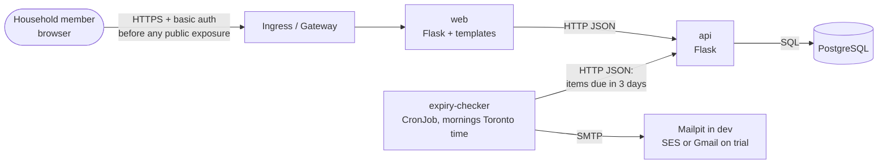

# FreshTrack — Architecture

Last updated: 2026-10-25

**Status rule:** a part is marked **Built** only when it is merged to `main` and verified.
Everything else is **Planned**. Built so far: the CI stages CHECK, BUILD, PROVE, SCAN and SHIP
(section 9; BUILD to SHIP for the api image only), and the `main` branch ruleset.
The api has only `/health` and `/ready` so far, so it is still Planned.

---

## 1. What FreshTrack does (plain language)

A household writes down the food it buys: what it is, how much, where it is stored
(fridge, freezer or cupboard) and the date on the label. FreshTrack shows the list
with the soonest dates at the top. Every morning it emails the household the items
that are within 3 days of their date or already past it.

FreshTrack **organises reminders**. It never says whether food is safe to eat.

## 2. Version 1 scope

| In scope | Out of scope (ask Samson first) |
|---|---|
| Add an item: name, quantity, location, label date, date type (best before / expiration date) | Account registration |
| Active list, closest date first | Multiple households |
| Mark an item as used or discarded (it stays in the database as trial data) | Native mobile app |
| One morning email (America/Toronto) to one household address | Barcode or receipt scanning |
| Wording that distinguishes best before from expiration date | Recipes, automatic grocery ordering |

## 3. Components

| Component | What it is | Job | Status |
|---|---|---|---|
| **web** | Flask + HTML templates, no JavaScript framework | The pages people see. Has no database access; it calls the api. | Planned |
| **api** | Flask (JSON over HTTP) | All the rules, and the only component that reads or writes the database. | Planned |
| **expiry-checker** | Python script run by a Kubernetes CronJob | Every morning, asks for due items and sends one email. | Planned |
| **PostgreSQL** | Database | Stores items, including used and discarded ones. | Planned |
| **Mailpit** | Fake mail server (dev/test only) | Catches emails so no real email is sent while we test. | Planned |

Every app exposes `/health` (am I alive?) and `/ready` (can I reach what I need?
For the api, that means the database).

## 4. How the parts talk (planned)



Kitchen analogy: **web** is the waiter, **api** is the kitchen, and **PostgreSQL** is the
walk-in fridge. Only the kitchen goes into the fridge. **expiry-checker** is the
morning prep cook who asks the kitchen "what needs using up?" and pins a note on
the board (the email).

### Flow A — adding an item
1. The user fills in the form on **web**.
2. **web** sends the data to **api** (`POST /items`).
3. **api** checks it (valid location, valid date type, date present) and saves it to **PostgreSQL**.
4. **web** shows the updated list.

### Flow B — the morning reminder
1. The Kubernetes CronJob starts **expiry-checker** each morning, America/Toronto time.
2. **expiry-checker** asks **api** for active items whose date is within 3 days or already past.
3. If there are any, it builds one email with separate "Best before" and "Expiration date" wording
   and sends it to the configured household address.
4. It exits. Success or failure shows in the Job status and logs.

## 5. Data model (planned, one table)

`items`

| Column | Type | Notes |
|---|---|---|
| id | integer, primary key | |
| name | text | e.g. "Greek yogurt" |
| quantity | text | Free text such as "2 cartons" or "500 g", kept simple for v1 |
| location | `fridge` / `freezer` / `cupboard` | Enforced by the database |
| label_date | date | The date printed on the package |
| date_type | `best_before` / `expiration` | Changes the reminder wording ("Best before" / "Expiration date") |
| status | `active` / `used` / `discarded` | Rows are never deleted |
| created_at | timestamp | |
| closed_at | timestamp, empty while active | When it was used or discarded |

The household email address is **not** stored in the database. It comes from config or a Secret.

## 6. Where it runs

| Environment | Purpose | Email | Status |
|---|---|---|---|
| Laptop (WSL Ubuntu) | Write and test code | Mailpit | Planned |
| Minikube (main lab, multi-node when useful) | Learn and practise Kubernetes, failure drills | Mailpit | Planned |
| k3s on AWS EC2, ca-central-1 (about 1 week) | Household trial and demo | Amazon SES sandbox or Gmail App Password (to decide) | Planned |

AWS infrastructure is defined in a separate repo, `terraform-aws-platform`.
**Cost rule:** destroy AWS resources after demo days.

## 7. Kubernetes objects: where each one fits FreshTrack (planned)

| Object | FreshTrack use |
|---|---|
| Namespace | `freshtrack` keeps all our objects in one labelled shelf |
| Pod, ReplicaSet, Deployment | web and api; practise rolling update and rollback |
| Service (ClusterIP) | Stable internal address for web and api |
| Service (headless) | Stable network identity for the PostgreSQL StatefulSet |
| StatefulSet, PVC, PV, StorageClass | PostgreSQL with storage that survives Pod restarts |
| ConfigMap | Non-secret settings: time zone, reminder window (3 days), api URL |
| Secret | Database password, SMTP credentials, household email address |
| Job | One-off database setup (create the table) and manual runs of the checker |
| CronJob | expiry-checker each morning, using `timeZone: America/Toronto` |
| Ingress or Gateway API | Entry point to web; TLS + basic auth before public exposure |
| ServiceAccount, RBAC | One identity per app, with only the permissions it needs (mostly none) |
| NetworkPolicy | Only web→api, checker→api and api→PostgreSQL are allowed; everything else is blocked |
| Probes | Liveness → `/health`, readiness → `/ready` |
| Requests and limits | Every container gets a fair, capped share of CPU and memory |
| HPA | web/api scale on CPU during a load-test drill (a household doesn't need it, so we'll say that honestly) |
| PodDisruptionBudget | Keeps at least one api Pod running while a node is drained |
| DaemonSet | Grafana Alloy on every node, collecting logs for Loki |
| Nodes, taints/tolerations, affinity | Multi-node Minikube: PostgreSQL pinned to a "data" node, web replicas spread across nodes |

## 8. Security and privacy (planned)

- No user accounts in v1. The grocery list is still personal, so access is restricted.
- **Before any internet exposure:** TLS + basic authentication at the Ingress/Gateway.
- Secrets live in OpenBao/Vault and are synced into Kubernetes by External Secrets
  Operator. Reloader restarts Pods when a secret changes. Secrets are never baked
  into images and never committed.
- Hardened images: pinned base image digest, hash-locked dependencies, non-root user, small image.
- NetworkPolicies limit who can talk to whom.

## 9. Delivery pipeline (CHECK to SHIP built for the api)

**Check → Build → Prove → Scan → Ship.** Like a food factory: inspect the ingredients,
cook, taste, get QC release, dispatch. Each stage is a gate; a failure stops everything after it.

| # | Stage | Factory version | What it does | What it catches | Status |
|---|---|---|---|---|---|
| 1 | CHECK | Incoming raw-material inspection | One job, `checks`, with steps in order: lint + format check (Ruff), unit tests (pytest), code scan (bandit), source scan (Trivy `fs`: vulnerable packages + secrets) | Messy or broken code, wrong logic, risky Python patterns, vulnerable runtime packages, committed secrets | **Built** (PR #4, #5) |
| 2 | BUILD | Production | Build the Docker image for web, api and expiry-checker, tagged with the commit SHA | Dockerfile errors, missing dependencies | **Built** for the api (PR #7); web and expiry-checker Planned |
| 3 | PROVE | Taste test on the line | Start the container and call `/health` (the checker runs a dry run) | An image that builds but won't start | **Built** for the api (PR #7) |
| 4 | SCAN | QC release testing | Trivy image scan: fail on fixable HIGH/CRITICAL, report everything | Vulnerabilities and secrets in the base image, OS packages and Python packages | **Built** for the api (PR #7) |
| 5 | SHIP | Dispatch | Push to Docker Hub tagged with the git SHA, **only on `main`** | Nothing new: it only releases what passed every gate. A token in the `main`-only environment `dockerhub` | **Built** for the api (PR #10) |

```
Built today (.github/workflows/ci.yml, two jobs):

push (any branch) / PR → Ruff lint → Ruff format → pytest → bandit → Trivy fs
  → build api image (tag = commit SHA) → start it, call /health
  → docker save → Trivy image: full report → Trivy image: gate
  → (main only) hand image.tar to the ship job as an artifact (kept 1 day)
  → show container logs (always)
                          (a failed step stops the steps after it)

job "ship" (push to main only, needs: checks, environment: dockerhub):
  download image.tar → docker load → tag samayohub/freshtrack-api:<commit SHA>
  → docker login (token via stdin) → docker push → docker logout (always)
SonarCloud runs alongside through Automatic Analysis (its GitHub app, not ci.yml).
Its quality gate must pass before merge.
```

**What the pipeline does not cover yet (honest limits)**
- Tests use no real PostgreSQL yet; the database check is tested against an unreachable address.
  Tests against a real PostgreSQL are planned with the first SQL code.
- Trivy `fs` reads `api/requirements.txt` (runtime packages) but not `api/requirements-dev.txt`
  (pytest, Ruff, bandit). Dev tools never go into the image.
- Trivy `fs` scans files as they are now, not old commits. Git history secret scanning (gitleaks) is not in place.
- Misconfiguration scanning (Dockerfile, Kubernetes) is not on yet. The Dockerfile exists now; Kubernetes files do not.
- The image is scanned only when code is pushed. A weekly scheduled re-scan (to notice new fixes) is planned.
- The image gate ignores HIGH/CRITICAL vulnerabilities with no fix yet; they still ship and are listed in the full report.

**Triggers:** every push to any branch, and every pull request. Once a PR is open,
each push runs CI twice (`push` and `pull_request`); accepted because a run takes about 40 seconds.

**Security**
- Workflow token is read-only (`permissions: contents: read`); checkout keeps no Git token (`persist-credentials: false`).
- Every action is pinned to a full commit SHA, verified against its real release tag.
- Trivy runs from its official image pinned by digest, not through `trivy-action` (its tags were hijacked in March 2026).
- Python packages install only as wheels and only if their hashes match the lock file
  (`--only-binary :all: --require-hashes`).
- The Docker Hub token (Read & Write, 90-day expiry) is a secret in the GitHub environment `dockerhub`,
  which only the `main` branch may use. Feature branches and pull requests never see it.
  The username is an environment variable (not sensitive). Login uses `docker login --password-stdin`, not a third-party action.
- The image is scanned before it is pushed: `ship` needs `checks`, so a vulnerable image never reaches the registry.
- The image that ships is the exact file that was scanned (passed as an artifact), not a rebuild.
- Tags are the commit SHA only, never `latest`, so every published image traces back to one commit.
- The `main` branch is protected by the ruleset `protect-main`: pull request required (squash only, 0 approvals
  because I work alone), `checks` and `SonarCloud Code Analysis` must pass, branch must be up to date,
  no force push, no deletion, empty bypass list. Tested: a direct push was rejected (GH013).
- Trivy reads the image as a read-only tar file (`docker save`), never through the Docker socket.
- The api image runs as non-root user 10001, from a base image pinned by digest.

**Speed**
- Branch and PR runs: about 50 seconds (`checks` only). A `main` run with SHIP: about 1 min 22 s
  (run `40141996431`: `checks` 49 s, `ship` 26 s, plus the artifact hand-off).
- Earlier, before SHIP: about 40 seconds (run `38953043940`). The two image-scan steps share one
  Trivy database download (`--cache-dir`); no other caches are used.
- `timeout-minutes: 10` on each job. `concurrency` cancels outdated pull request runs; runs on `main` are never cancelled.
- Decided at BUILD: one job for now, so the image built in one step is still there for the next steps.
  Decided at SHIP: a separate `ship` job, so the token lives only in a `main`-only job; the image reaches it as an artifact.
  Separate jobs per app are reconsidered when web and expiry-checker get images.

**Limits (what CI does not catch):** logic with no test, wrong settings inside the
cluster, and runtime failures such as the database being down. Probes, Argo CD and monitoring cover those.

**Deploy (CD):** CI pushes the image. The new tag is written into Git (method to be chosen),
and Argo CD sees the change and syncs the cluster. In short: CI pushes, GitOps pulls.

## 10. Observability (planned)

Prometheus (metrics), Grafana (dashboards), Loki + Grafana Alloy (logs),
Alertmanager (alerts). A first useful alert: "the morning reminder Job failed."

## 11. Tools and their alternatives

| Role | We use | Alternative |
|---|---|---|
| Source control | Git + GitHub | GitLab |
| CI/CD | GitHub Actions | GitLab CI, Jenkins |
| Code quality | Ruff + SonarCloud | SonarQube Community |
| Python code security scan | bandit | Semgrep |
| Source scan (packages + secrets) | Trivy `fs` | pip-audit + gitleaks |
| Image scan | Trivy | Grype |
| Registry | Docker Hub | Harbor |
| Local cluster | Minikube | kind |
| Cloud cluster | k3s on AWS EC2 | EKS |
| Cloud infrastructure | Terraform | OpenTofu |
| Server configuration | Ansible | cloud-init |
| Packaging | Helm | Kustomize |
| GitOps | Argo CD | Flux |
| Secrets | OpenBao/Vault + External Secrets Operator + Reloader | Sealed Secrets, SOPS |
| Monitoring | Prometheus, Grafana, Loki, Alloy, Alertmanager | VictoriaMetrics |

Versions are chosen when each tool is introduced, after checking its official docs.

## 12. Open decisions

| # | Question | Current proposal |
|---|---|---|
| 1 | Does expiry-checker read the database directly, or ask the api? | **Decided (2026-10-09):** it asks the api. Only the api touches the database, so the "due within 3 days" rule lives in one place |
| 2 | Ingress or Gateway API? | Decide at the networking stage after checking current docs (community ingress-nginx is retired) |
| 3 | Trial email: Amazon SES sandbox or Gmail App Password? | Decide before the AWS trial |
| 4 | Morning email time | Proposal: 07:00 America/Toronto |
| 5 | Send an email on days with nothing due? | Proposal: no email. The Job still logs "0 items due" |
| 6 | Label wording: "expiry" vs Canada's "expiration date" | **Decided (2026-10-09):** "Expiration date" (stored as `expiration`) |
